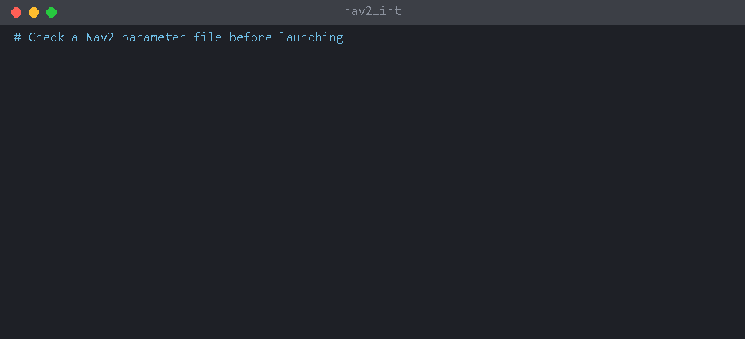

[中文](README.zh-CN.md) | [ENG](README.md)

# nav2lint

ROS 2 Nav2 参数文件（`nav2_params.yaml`）的静态检查工具。不需要安装 ROS，也不会启动 Nav2，几毫秒内就能指出出错的行。

Nav2 参数写错，通常要等到启动后才在日志里看到一条难懂的类型错误，或者因为该值被悄悄忽略而根本没有报错。nav2lint 能在启动前检查其中的许多问题，但不能替代实际运行验证。



**第一次用？** 先看 [5 分钟上手](docs/quickstart_zh.md)，照着做就能跑起来。更详细的说明见[中文使用指南](docs/user_guide_zh.md)。

## 项目状态

**第一阶段完成，自 2026-11-03 起转为维护模式。** 最新 Release 为 [v0.3.1](https://github.com/Leonhart999/nav2lint/releases/tag/v0.3.1)。继续接受可复现的 bug、误报和文档纠错；新增功能留待有明确使用需求时再评估。仓库不归档，不承诺固定响应时间或未来发行版支持。

已交付能力、验证依据、已知限制和问题反馈方式见[阶段总结与维护计划](docs/project_status_zh.md)。`main` 上的文档可能比版本标签中的更新。

## 安装

```bash
pip install -e .        # 在本仓库目录下执行
```

唯一的依赖是 PyYAML。需要 Python 3.9 及以上，支持 Windows、Linux 和 WSL。

在 ROS 2 环境中（已经装有 PyYAML），也可以不安装直接运行：

```bash
PYTHONPATH=/path/to/nav2lint/src python3 -m nav2lint nav2_params.yaml
```

## 用法

```bash
nav2lint nav2_params.yaml                 # 自动检测发行版
nav2lint --distro humble nav2_params.yaml # humble / jazzy / kilted / rolling
nav2lint --distro jazzy old_humble.yaml   # 迁移前检查：Humble 配置在 Jazzy 上会出哪些问题
nav2lint --format json *.yaml             # JSON 输出，适合 CI
nav2lint --strict --info params.yaml      # 有 warning 也返回非零；显示 info 级别结果
nav2lint --distro humble ~/ros2_ws/src    # 目录：检查其中所有 Nav2 参数文件
nav2lint --watch --distro humble ~/ros2_ws/src   # 每次保存后重新检查，Ctrl+C 停止
nav2lint --format line params.yaml        # 每条结果一行，提示内联（便于编辑器和 grep）
nav2lint --diff --distro jazzy old.yaml   # 以 diff 形式显示自动修复，不改动文件
nav2lint --fix --distro jazzy old.yaml    # 直接修改文件，然后报告剩余问题
```

检查目录时，nav2lint 只挑出含有 Nav2 节点 `ros__parameters` 段的 YAML 文件，并跳过隐藏目录和 colcon 的 `build/`、`install/`、`log/`。命令行中明确指定的文件总会被检查。

文件检查的退出码：没有 error 时为 0；有 error 时为 1（使用 `--strict` 时 warning 也算）；文件无法读取或配置文件无效时为 2。`--diff` 仅作预览，成功预览时即使存在改动也返回 0；CI 判断是否通过应使用普通检查。

## 解释规则与查询参数依据

```bash
nav2lint --explain T404
nav2lint --describe controller_server.controller_frequency --distro humble
nav2lint --describe plugin:nav2_costmap_2d::InflationLayer.inflation_radius --distro jazzy
nav2lint --describe plugin:dwb_core::DWBLocalPlanner/PathAlign.scale --distro humble
nav2lint --describe amcl.initial_pose.x --distro humble --format json
```

查询不需要输入文件，支持文本或 JSON 输出。`--describe` 必须显式指定一个受支持的 `--distro`，不会从当前目录的配置中推断。插件查询用 `::` 分隔类名，用 `/` 表示子参数组。查询 `controller_server.FollowPath.max_vel_x` 这样的插件实例时，没有文件就无法推断它的类，请改用明确的插件类。

依据分为三类：从源码提取的参数表、官方参考 YAML、rclcpp 内置约定。提取得到的条目会注明对应的 Nav2 commit 和数据文件；目前不记录每个参数在 C++ 源码中的具体位置。“参数已知但类型未知”与“参数不在表中”是两回事。内置的任何作用域都不声称完整，参数不在表中**并不能**证明 Nav2 会忽略它。

E102 和 T404 的 JSON 输出带有额外的 `evidence` 数组，其他规则目前为空，它们的依据可以用 `--explain` 查看。查询成功时退出码为 0，即使结果是 `not_in_tables` 或 `unknown_scope`；查询格式错误或规则编号未知时退出码为 2。

## 自动修复

`--fix` 只应用正确写法没有歧义的修复，其余留给你处理。它只改动受影响的行，注释、顺序和换行符都保持原样。建议先用 `--diff` 查看。

| 规则 | `--fix` 做什么 |
|---|---|
| N003 | `ros_parameters` -> `ros__parameters` |
| E101 | 混合内联数组中的整数改为浮点数；内联嵌套的 `footprint` 改为带引号的字符串 |
| E102 | double 参数 `1` -> `1.0`，整数参数 `2000.0` -> `2000`，内联整数数组改为浮点数组 |
| D201 | 按目标发行版互换插件分隔符 `/` 和 `::`（仅限 Nav2 自带插件） |
| D202 | `progress_checker_plugin: "x"` 与 `progress_checker_plugins: ["x"]` 互换 |
| D203 | behavior_server 话题参数改名 |
| D204 | 从 `plugin_lib_names` 中删除内置 BT 节点（列表为空时删除整个键） |
| D207 | `viz_expansions` -> `debug_visualizations` |
| D209 | `global_frame: odom` -> `local_frame: odom` + `global_frame: map` |
| D210 | collision polygon 的 `points` 在扁平数组和字符串形式之间转换 |
| S304 | `max_accel` / `max_decel` 的正负号 |

拼写类结果（T401–T404）从不自动修复，因为建议可能是错的。修复只作用于内联值，块状列表不会改动。

用 `--fix --distro jazzy` 迁移官方 Humble 配置，会应用 11 处修复，之后没有 error 或 warning。

## 配置与抑制

文件所在目录或任意上级目录中的 `.nav2lint.yaml` 会作用于其下所有文件：

```yaml
distro: humble          # 未给出 --distro 时使用
disable: [S301]         # 关闭的规则
severity:               # 修改规则的严重级别
  T404: info
```

`--config FILE` 使用指定的配置文件，`--no-config` 忽略所有配置文件。命令行中的 `--distro` 优先于配置文件。

要屏蔽单条结果，在参数文件中加注释：

```yaml
use_sim_time: False  # nav2lint: disable=S301            本行
# nav2lint: disable-next-line=T404                        下一行
# nav2lint: disable-file=S305                             整个文件
# nav2lint: disable                                       本行所有规则
```

多个规则编号用逗号分隔，后面的文字会被忽略，可以写上原因。注释中未知的规则编号会报告为 N005。被抑制的结果会计入汇总，且不会被自动修复。

## VS Code

用已安装 nav2lint 的 Python 环境生成任务：

```bash
# 在 VS Code 要打开的工作区根目录下运行。
nav2lint --init-vscode .
# 在 Linux/WSL 上，可以显式指定 Python 命令。
nav2lint --init-vscode . --python python3
```

默认使用当前解释器。`--python` 用于显式指定命令；它不会安装 nav2lint，也不会检查该环境。使用 Remote-WSL 时，请在 WSL 中用装有 nav2lint 的 WSL Python 初始化；使用 Windows 的 VS Code 窗口时，请用 Windows 解释器。生成的绝对解释器路径与具体环境有关：换机器时请重新生成，或选择该机器 PATH 中可用的命令。

初始化会把缺少的 nav2lint 任务合并进 `.vscode/tasks.json`，保留已有任务（包括同名的自定义任务）；遇到不安全或格式错误的输入时拒绝执行，不改动文件。支持 JSONC 注释和尾随逗号；插入时保留原有文本、注释、BOM 和换行符。两个任务都需要从 *Tasks: Run Task* 手动启动；初始化不会运行任务，也不会开启打开文件夹时自动执行。

- **nav2lint: watch workspace**：任务运行期间持续重新检查 Nav2 参数文件。
- **nav2lint: check current file**：检查当前打开的文件一次。

问题匹配器会把结果显示在 VS Code 的“问题”面板中。请在工作区的 `.nav2lint.yaml` 中设置 `distro: <你的发行版>`。[editors/vscode/tasks.json](editors/vscode/tasks.json) 是可移植的手动复制方案，请按环境调整其中的 Python 命令。

### 任务列表中找不到任务

1. 在 VS Code 中打开**工作区根目录**，而不只是某个 YAML 文件或子文件夹。运行 *Tasks: Run Task*，必要时选择 *Show All Tasks*。任务名称不是可以在命令面板中直接运行的命令。
2. 只有在认可工作区内容时才信任它。如果任务文件是在外部修改的，保存工作后重新加载 VS Code 窗口。
3. 已有的同名任务不会被自动升级。请检查它们的 `command` 和平台相关设置；新生成的任务总是带有顶层 `command`。
4. Windows 版 VS Code 通过 UNC 共享访问 WSL 文件夹时，可能报告文件监视错误，但这不能解释所有任务缺失的情况。建议使用 Remote-WSL，或者用一个本地 `.code-workspace` 文件，其中包含 WSL 文件夹 URI 和从模板复制的工作区级 `tasks` 对象。打开该工作区文件，并在使用 Windows 版 VS Code 时选择 Windows 解释器。
5. 在只有 Python 3 的系统上使用 `python3`，不要用 `python`。如果你是用临时的 `PYTHONPATH` 运行命令行的，请先在任务所用的环境中安装 nav2lint，或者显式配置该环境。不要为了初始化编辑器任务而使用 `sudo`。

例如，在 WSL 终端中，已有 `~/ros2_ws` 工作区，且当前解释器装有 nav2lint：

```bash
cd ~/ros2_ws
python3 -m nav2lint --init-vscode .
```

通用示例中的 `/path/to/nav2lint` 这类路径需要替换为实际的仓库路径，它们不是真实的安装位置。

## 示例

[examples/broken_humble.yaml](examples/broken_humble.yaml) 的输出（程序输出为英文）：

```
examples/broken_humble.yaml:4: warning[S307] amcl.min_particles=500 is greater than max_particles=200
examples/broken_humble.yaml:7: warning[T401] unknown node name `controler_server`
    did you mean `controller_server`?
examples/broken_humble.yaml:14: warning[T404] `FollowPath.angular_dist_threshold` is not in the bundled parameter tables for this scope (humble)
    tables may be incomplete; verify the target distro and plugin documentation
examples/broken_humble.yaml:15: warning[N002] duplicate key `plugin` (first defined on line 13); the later value silently wins
examples/broken_humble.yaml:21: warning[S301] `local_costmap` use_sim_time differs from the other 3 nodes
examples/broken_humble.yaml:22: error[E101] `footprint` is a nested list; ROS 2 parameters do not support nested arrays
    Nav2 expects footprint as a string: footprint: "[[0.2, 0.2], [0.2, -0.2], ...]"
examples/broken_humble.yaml:26: error[E102] `inflation_layer.inflation_radius` should be float but is int; Nav2 will fail with a parameter type mismatch
    write 1.0
examples/broken_humble.yaml:33: warning[S303] `voxel_layer.scan` raytrace_max_range=2.0 is less than obstacle_max_range=3.0; obstacles marked between 2.0 and 3.0 m are never cleared
examples/broken_humble.yaml:37: error[N004] the global_costmap node's full name is /global_costmap/global_costmap, so its parameters need two levels of nesting
examples/broken_humble.yaml:43: error[E101] `max_velocity` mixes float / int; ROS 2 arrays must have a single element type
    write integers as floats, e.g. 0 -> 0.0
examples/broken_humble.yaml:46: error[S304] velocity_smoother.max_decel must be non-positive (deceleration is negative); Nav2 throws during configure
5 error, 6 warning, 0 info; 4 fixable with --fix
```

## 规则

| 编号 | 级别 | 检查内容 |
|---|---|---|
| N001 | error | YAML 语法错误（带行号），或文件不是 UTF-8 编码 |
| N002 | warning | 重复的键（PyYAML 和 ROS 2 都会悄悄保留最后一个值） |
| N003 | error | 顶层节点下没有 `ros__parameters`，或误写为 `ros_parameters` |
| N004 | error | costmap 只嵌套了一层（应为 `local_costmap: local_costmap: ros__parameters`） |
| N005 | warning | `# nav2lint:` 注释中有未知的规则编号 |
| N006 | error/warning | 参数缩进到与 `ros__parameters` 同级而不是在它下面（error）；`ros__parameters` 为空（warning） |
| E101 | error | 数组混用 int/float，或嵌套数组（通常是把 footprint 写成了列表） |
| E102 | error | 类型与 Nav2 声明的不一致，例如 double 参数写成整数 `1` |
| P101 | error/warning | 插件列表中列出的名字没有对应的定义 |
| P102 | error | 插件实例缺少 `plugin` 字段（Nav2 默认 id 除外） |
| P103 | info | costmap 图层已定义，但不在 `plugins`/`filters` 中，因此不会被加载 |
| D201 | error/warning/info | 插件分隔符：Jazzy 起 Nav2 插件用 `pkg::Class`；Humble 中部分包用 `pkg/Class`。Jazzy 起第三方插件写成 `pkg/Class` 只报 info，因为名字由它自己的 plugin XML 决定 |
| D202 | warning | `progress_checker_plugin`（Humble）与 `progress_checker_plugins`（Jazzy 起） |
| D203 | warning | behavior_server 参数改名，例如 `costmap_topic` -> `local_costmap_topic` |
| D204 | warning | Jazzy 起 `plugin_lib_names` 只列自定义 BT 节点，内置节点自动加载 |
| D205 | error/warning | Kilted 起 `error_code_names` 必须换成 `error_code_name_prefixes` |
| D206 | warning | Kilted 起 `dock_backwards` 改为 dock 插件的 `dock_direction` |
| D207 | warning | Jazzy 起 Smac Hybrid 的 `viz_expansions` -> `debug_visualizations` |
| D208 | warning | Jazzy 起 RPP 的 `use_interpolation` 已弃用 |
| D209 | warning | Jazzy 起 behavior_server 分别设置 `local_frame` / `global_frame` |
| D210 | error | collision_monitor 多边形 `points`：Humble 中为扁平数组，Jazzy 起为字符串 |
| D211 | warning | Humble 起 `recoveries_server` 改名为 `behavior_server` |
| S301 | warning | 各节点的 `use_sim_time` 不一致 |
| S302 | warning | `inflation_radius` 小于机器人半径（由 robot_radius 或 footprint 计算） |
| S303 | warning | `raytrace_max_range` < `obstacle_max_range`，远处的障碍物永远不会被清除 |
| S304 | error | velocity_smoother 的数组长度不是 3、加速度为负、减速度为正、最小值大于最大值 |
| S305 | warning | 控制器最大速度超过 velocity_smoother 的限制（DWB / MPPI / RPP / Graceful） |
| S306 | warning | MPPI 的 `model_dt` 不等于 1/controller_frequency；预测时域超出局部 costmap |
| S307 | warning | AMCL 的 `min_particles` > `max_particles` |
| T401–T403 | warning | 节点名、插件名或参数名可能拼错，并给出“did you mean”提示 |
| T404 | warning | 参数不在该作用域和发行版的内置参数表中；表可能不完整，并会提示记录了该参数的其他发行版 |

### 工作原理

- 每个发行版的参数名和类型有两个来源：
  - 由 [tools/extract_params.py](tools/extract_params.py) 从 Nav2 源码中提取的参数表（见 [src/nav2lint/data/](src/nav2lint/data/)）：识别 `declare_parameter`、`declare_parameter_if_not_declared`、costmap 的 `declareParameter`、MPPI 的 `getParam`、DWB 的 `searchAndGetParam` 和 `declare_or_get_parameter` 调用，以及 Python 节点（Jazzy/Kilted 的 loopback simulator）中的 `self.declare_parameter`，类型取自默认值。每个发行版在所有节点和内置插件中约有 1,000–1,700 个参数；
  - 各发行版官方的 `nav2_bringup/params/nav2_params.yaml`（见 [src/nav2lint/refs/](src/nav2lint/refs/)），用于补充提取器遗漏的少量参数。
- T404 只对参数表中有的节点和插件生效。第三方插件和节点只做结构检查和保守的 T403 拼写检查：只有当键名中某个单词不认识时才报告，例如 `inflation_raduis`。
- 迁移规则（D2xx）来自 Nav2 官方迁移指南，并对照各分支的 navigation2 源码核实。
- 发行版自动检测依据只有部分发行版才使用的写法（例如 `nav2_behaviors/Spin`、`error_code_name_prefixes`）。无法判断时会跳过 D2xx 规则，并提示你传入 `--distro`。如果文件已经用了比其发行版更新的写法，自动检测可能出错，所以知道发行版时请传入 `--distro`。

### 已知限制

- 不解析 launch 文件中的参数覆盖（`RewrittenYaml`、由 launch 传入的 `use_sim_time`）。
- 不检查行为树 XML 文件。
- 第三方插件的参数只做结构检查，不做类型检查。
- 参数表是对 Nav2 源码的静态解读。通过特殊辅助函数声明的参数可能遗漏，表现为 T404 误报，欢迎反馈。

## pre-commit

在使用方仓库的 `.pre-commit-config.yaml` 中加入：

```yaml
repos:
  - repo: https://github.com/Leonhart999/nav2lint
    rev: v0.3.1
    hooks:
      - id: nav2lint
```

该 hook 不会自动修复。相关 YAML 发生改动时，它按 Nav2 的识别规则扫描 `.`，而不是把每个 YAML 文件（例如地图描述文件）都当作参数文件。扫描的是工作树，不只是已暂存的文件，因此可能报告原有的问题。请在 `.nav2lint.yaml` 中设置目标发行版；想让 warning 也阻止提交，可添加 `args: [., --strict]`。

## 开发

```bash
pip install -e '.[dev]'
pytest
```

### 重新生成参数表

`src/nav2lint/data/` 中的参数表记录了生成时所用的 navigation2 commit。重新生成时，先下载并解压对应分支，再运行提取器：

```bash
curl -L -o nav2_humble.tar.gz https://api.github.com/repos/ros-navigation/navigation2/tarball/humble
mkdir src_humble && tar -xzf nav2_humble.tar.gz -C src_humble --strip-components=1
python tools/extract_params.py src_humble humble src/nav2lint/data/humble.json --commit <sha>
```

`rolling` 使用 `main` 分支。重新生成后运行 `pytest`：测试会检查每个发行版的官方配置，必须没有 error 或 warning。

## 许可证

Copyright 2026 Leonhart999。以 [Apache License 2.0](LICENSE) 授权。

`src/nav2lint/refs/` 下的参考配置和 `src/nav2lint/data/` 下的参数表源自 [ros-navigation/navigation2](https://github.com/ros-navigation/navigation2)（Apache-2.0），详见 [NOTICE](NOTICE)。
