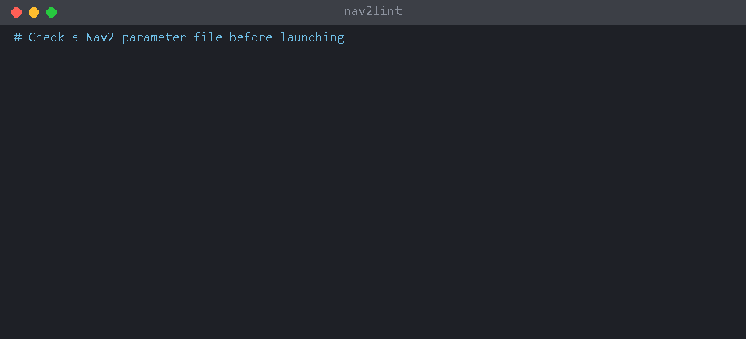

[中文](quickstart_zh.md) | [ENG](quickstart.md)

# 5-minute quick start

This page is for first-time users. You do not need to know how nav2lint works; just follow the steps.



## What it does for you

All Nav2 parameters live in one YAML file, usually called `nav2_params.yaml`. A mistake in it often shows up only after `ros2 launch`, buried in a long log. Sometimes there is no error at all, and the parameter just silently has no effect.

nav2lint reads the file before you launch and tells you **which line** has a problem and how to fix it. It does not start ROS and does not touch your robot.

## What you need

- **Python 3.9 or newer.** Ubuntu with ROS 2 already has it.
- **A Nav2 parameter file.** It is usually in the `config/` or `params/` directory of your own package. If you are not sure where it is, run this in a terminal to list the YAML files in your workspace that look like ROS 2 parameter files:

  ```bash
  grep -rl --include=*.yaml ros__parameters ~/ros2_ws/src
  ```

  Replace `~/ros2_ws` with your own workspace directory.

## Step 1: install

**Ubuntu 22.04 (ROS 2 Humble)**, run in a terminal:

```bash
python3 -m pip install --user "nav2lint @ https://github.com/Leonhart999/nav2lint/archive/refs/tags/v0.3.1.zip"
```

**Ubuntu 24.04 (ROS 2 Jazzy)** does not let pip install packages into the system Python (you get `externally-managed-environment`). Use pipx instead:

```bash
sudo apt install pipx
pipx install "nav2lint @ https://github.com/Leonhart999/nav2lint/archive/refs/tags/v0.3.1.zip"
pipx ensurepath
```

**Close the terminal and open a new one**, then check the installation:

```bash
nav2lint --version
```

If you see `nav2lint 0.3.1`, it is installed. If you get `command not found`, see [Common problems](#common-problems) below.

## Step 2: find your ROS 2 version

nav2lint needs to know which ROS 2 distro you use, because parameter syntax differs between versions. Run:

```bash
ls /opt/ros
```

It shows a name such as `humble` or `jazzy`. Use that name in the commands below.

## Step 3: check

Go to the directory that contains your parameter file, then run the check. The example uses `~/ros2_ws/src/my_robot/config`; use your own directory and file name:

```bash
cd ~/ros2_ws/src/my_robot/config
nav2lint --distro humble nav2_params.yaml
```

## Step 4: read the result

The output looks like this:

```
nav2_params.yaml:3: warning[S307] amcl.min_particles=500 is greater than max_particles=200
nav2_params.yaml:12: error[E102] `inflation_layer.inflation_radius` should be float but is int; Nav2 will fail with a parameter type mismatch
    write 1.0
1 error, 1 warning, 0 info; 1 fixable with --fix
```

Taking the second finding apart:

| Part | Meaning |
|---|---|
| `nav2_params.yaml:12` | File name and **line number**: the problem is on line 12 |
| `error` | Severity, see the table below |
| `[E102]` | Rule ID, for looking up details |
| `` `inflation_layer.inflation_radius` should be float but is int `` | The problem: this parameter needs a decimal number, but you wrote an integer |
| `write 1.0` (the indented line) | How to fix it: write `1.0` |

The last line is the summary: 1 error and 1 warning, and 1 of them can be fixed automatically.

**What the severities mean:**

| Severity | Meaning | Do I need to fix it? |
|---|---|---|
| `error` | Nav2 will fail to start, or the parameter has no effect at all | **Yes** |
| `warning` | Nav2 starts, but probably not the way you intended, e.g. an ignored parameter or contradictory values | Review each one |
| `info` | For reference only; hidden by default | Optional |

**Don't understand a finding?** Look up its rule ID:

```bash
nav2lint --explain E102
```

> About `T404` (parameter not in the bundled tables): it means the parameter was not found in the Nav2 sources. Common causes are a typo, the wrong place in the file, or a parameter that only older Nav2 versions had. The tables are not guaranteed to be complete, though, so a T404 does not always mean you made a mistake. When in doubt, check the official Nav2 documentation.

## Step 5: fix

Some problems have exactly one correct fix, and nav2lint can apply it for you. **Preview** the changes first; this does not modify the file:

```bash
nav2lint --distro humble --diff nav2_params.yaml
```

Lines starting with `-` are the original lines, lines starting with `+` are the new ones. When they look right, apply them:

```bash
nav2lint --distro humble --fix nav2_params.yaml
```

Fix the remaining problems yourself: open the file and go to the reported line numbers. Then run Step 3 again until the summary shows `0 error`.

Tip: commit with git or make a backup copy first, so you can always undo a change.

## Check a whole workspace

Instead of naming each file, give a directory. nav2lint finds the Nav2 parameter files in it:

```bash
nav2lint --distro humble ~/ros2_ws/src
```

## Common problems

**`nav2lint: command not found`**
Close the terminal and open a new one first. If it still fails, use `python3 -m nav2lint` instead of `nav2lint`; it does exactly the same thing, e.g. `python3 -m nav2lint --version`.

**`python: command not found`**
On Ubuntu, type `python3`, not `python`.

**`error: externally-managed-environment`**
You are on Ubuntu 24.04. Install with pipx as shown in Step 1.

**`could not detect the distro ... use --distro to set it`**
nav2lint could not work out your ROS 2 version on its own. Find it as in Step 2 and add `--distro humble` (or `jazzy`, etc.) to the command.

**`no Nav2 parameter files found`**
No Nav2 parameter file was found in the directory you gave. Check the directory, or name the file directly.

**`cannot read: ... No such file or directory`**
The file path is wrong. Use `ls` to make sure the file is in the current directory, or give the full path.

**A `/path/to/...` command from the docs fails**
That is a placeholder. Replace it with the real path on your computer.

## Next steps

- Check while you edit in VS Code: see [the VS Code section of the README](../README.md#vs-code).
- Stop typing `--distro` every time: create a `.nav2lint.yaml` in your workspace root containing the line `distro: humble`.
- Every option and rule in detail: see the [README](../README.md).
