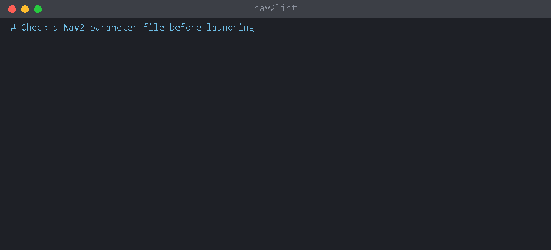

[中文](quickstart_zh.md) | [ENG](quickstart.md)

# 5 分钟上手

这一页写给第一次用 nav2lint 的人，不需要懂它的原理，照着做就行。



## 它能帮你做什么

Nav2 的参数都写在一个 YAML 文件里，通常叫 `nav2_params.yaml`。这个文件写错了，往往要等 `ros2 launch` 之后才在一大堆日志里看到报错，有时候甚至不报错，参数只是悄悄不生效。

nav2lint 在启动之前把这个文件读一遍，告诉你**第几行**有什么问题、怎么改。它不需要启动 ROS，也不会改动你的机器人。

## 准备

- **Python 3.9 或更高版本**。装了 ROS 2 的 Ubuntu 已经自带，不用另外装。
- **一份 Nav2 参数文件**。它一般放在你自己功能包的 `config/` 或 `params/` 目录下。不知道在哪的话，在终端里运行下面这条命令，它会列出工作空间里所有像 ROS 2 参数文件的 YAML：

  ```bash
  grep -rl --include=*.yaml ros__parameters ~/ros2_ws/src
  ```

  把 `~/ros2_ws` 换成你自己的工作空间目录。

## 第 1 步：安装

**Ubuntu 22.04（ROS 2 Humble）**，在终端里运行：

```bash
python3 -m pip install --user "nav2lint @ https://github.com/Leonhart999/nav2lint/archive/refs/tags/v0.3.1.zip"
```

**Ubuntu 24.04（ROS 2 Jazzy）** 不允许直接用 pip 往系统里装包（会报 `externally-managed-environment`），改用 pipx：

```bash
sudo apt install pipx
pipx install "nav2lint @ https://github.com/Leonhart999/nav2lint/archive/refs/tags/v0.3.1.zip"
pipx ensurepath
```

装完**关掉终端再重新打开一个**，然后检查是否装好：

```bash
nav2lint --version
```

看到 `nav2lint 0.3.1` 就说明装好了。如果提示 `command not found`，见文末的[常见问题](#常见问题)。

## 第 2 步：确认你的 ROS 2 版本

nav2lint 要知道你用的是哪个 ROS 2 发行版，因为不同版本的参数写法不一样。运行：

```bash
ls /opt/ros
```

会显示 `humble`、`jazzy` 这样的名字，下面的命令里就填它。

## 第 3 步：检查

先进入参数文件所在的目录，再运行检查。下面以 `~/ros2_ws/src/my_robot/config` 为例，换成你自己的目录和文件名：

```bash
cd ~/ros2_ws/src/my_robot/config
nav2lint --distro humble nav2_params.yaml
```

## 第 4 步：看懂结果

输出大概长这样：

```
nav2_params.yaml:3: warning[S307] amcl.min_particles=500 is greater than max_particles=200
nav2_params.yaml:12: error[E102] `inflation_layer.inflation_radius` should be float but is int; Nav2 will fail with a parameter type mismatch
    write 1.0
1 error, 1 warning, 0 info; 1 fixable with --fix
```

拿第二条来拆开看：

| 这一段 | 意思 |
|---|---|
| `nav2_params.yaml:12` | 文件名和**行号**：问题在第 12 行 |
| `error` | 严重程度，见下表 |
| `[E102]` | 规则编号，想详细了解时用 |
| `` `inflation_layer.inflation_radius` should be float but is int `` | 问题是什么：这个参数应该写小数，你写成了整数 |
| `write 1.0`（缩进的那一行） | 怎么改：写成 `1.0` |

最后一行是汇总：1 个 error、1 个 warning，其中 1 个可以自动修复。

**严重程度怎么理解：**

| 级别 | 意思 | 要不要改 |
|---|---|---|
| `error` | Nav2 启动会失败，或者这个参数根本不生效 | **必须改** |
| `warning` | 能启动，但很可能和你想的不一样，比如参数被忽略、数值互相矛盾 | 建议逐条看一下 |
| `info` | 仅供参考，默认不显示 | 可以不管 |

**看不懂某一条？** 用规则编号查它的解释：

```bash
nav2lint --explain E102
```

程序的输出是英文的，看不懂可以把那一行复制到翻译软件里。

> 关于 `T404`（参数不在内置参数表里）：它的意思是“没在 Nav2 源码里找到这个参数”，常见原因是拼错了、放错了位置，或者是旧版本 Nav2 才有的参数。但 nav2lint 的参数表不一定完整，所以 T404 不一定代表你写错了，拿不准的时候对照一下 Nav2 官方文档。

## 第 5 步：修复

有些问题的改法是确定的，nav2lint 可以帮你改。**先预览**它打算改什么，不会动文件：

```bash
nav2lint --distro humble --diff nav2_params.yaml
```

输出里以 `-` 开头的是原来的行，以 `+` 开头的是改后的行。确认没问题后再真正修改：

```bash
nav2lint --distro humble --fix nav2_params.yaml
```

剩下的问题需要你自己打开文件、按行号去改。改完再运行一次第 3 步，直到汇总里显示 `0 error`。

建议：改之前先用 git 提交一次，或者备份一份文件，改错了可以随时恢复。

## 一次检查整个工作空间

不用一个个指定文件，直接给目录，nav2lint 会自己找出其中的 Nav2 参数文件：

```bash
nav2lint --distro humble ~/ros2_ws/src
```

## 常见问题

**`nav2lint: command not found`**
先关掉终端重新打开一次。还不行的话，用 `python3 -m nav2lint` 代替 `nav2lint`，效果完全一样，例如 `python3 -m nav2lint --version`。

**`python: command not found`**
Ubuntu 上要写 `python3`，不是 `python`。

**`error: externally-managed-environment`**
你用的是 Ubuntu 24.04，请按第 1 步里 pipx 的方法安装。

**`could not detect the distro ... use --distro to set it`**
nav2lint 没能自己判断出 ROS 2 版本，按第 2 步查到版本后，在命令里加上 `--distro humble`（或 `jazzy` 等）。

**`no Nav2 parameter files found`**
你给的目录里没有找到 Nav2 参数文件。检查目录是否正确，或者直接写出文件名。

**`cannot read: ... No such file or directory`**
文件路径不对。先用 `ls` 确认文件确实在当前目录，或者写出完整路径。

**文档里的 `/path/to/...` 照抄后报错**
那是占位符，需要换成你电脑上的真实路径。

## 下一步

- 想在 VS Code 里边写边检查：见 [README 的 VS Code 一节](../README.zh-CN.md#vs-code)。
- 不想每次都写 `--distro`：在工作空间根目录建一个 `.nav2lint.yaml`，里面写一行 `distro: humble`。
- 所有选项和规则的详细说明：见[中文使用指南](user_guide_zh.md)。
